<picture>
  <source media="(prefers-color-scheme: dark)" srcset="assets/header-dark.svg">
  
</picture>

  
  
  
  
  

  <code>LLM-as-judge</code> · <code>evals &amp; graders</code> · <code>golden sets</code> · <code>model routing</code> · <code>ensembling</code> · <code>self-consistency</code> · <code>agents</code> · <code>MCP</code> · <code>Claude Code</code>

## Shipping now

| | What | Proof |
|---|---|---|
| **[fustat.ai](https://fustat.ai)** | **Design-Goal Fit.** A critic reviews every screen against the business goal it should move. An LLM-as-judge scores the critique with a hallucination guard, and a persona ensemble (self-consistency sampled) reaches the verdict. Human overrides teach it the team's bar. | 20 customers in month one |
| **[korba.ai](https://korba.ai)** | An AI browser where you and your agents work side by side, sharing the same page, terminal and document. Teach it a skill by doing it once. | Free · local-first on macOS |
| **[telos](https://github.com/ProductVoyagers/telos)** | The open-source Claude Code plugin behind fustat: critique flows against Key Results, not taste. | Open source |
| **[pm-os](https://github.com/ritualspm/pm-os)** | The AI-native PM team OS: four agent roles on shared skills and files, installable in Claude Cowork. | Capstone of AI PM Builders |
| **[claude-101](https://github.com/ritualspm/claude-101)** | Learn Claude by using Claude: a 25-lesson interactive course that runs inside Claude. | Open course by rituals.pm |

<picture>
  <source media="(prefers-color-scheme: dark)" srcset="assets/fustat-dark.svg">
  
</picture>

<picture>
  <source media="(prefers-color-scheme: dark)" srcset="assets/evals-dark.svg">
  
</picture>

<picture>
  <source media="(prefers-color-scheme: dark)" srcset="assets/path-dark.svg">
  
</picture>

<b>The full path</b>: every role, chapter by chapter

### Applied AI at scale · 2022 → now

- **Delivery Hero** · Sr. Director of Product, Growth & AI, Quick Commerce 
  7 brands · 17 squads · 75 countries. Quick commerce grew from 4% to 12% of GMV contribution. I lead the AI practice for our teams.
- **ProductVoyagers Labs** · Founder 
  My AI studio: [fustat](https://fustat.ai), [korba](https://korba.ai) and [telos](https://github.com/ProductVoyagers/telos).
- **[rituals.pm](https://rituals.pm)** · Co-founder 
  AI PM Builders cohorts in English and Arabic. Open-sourced [pm-os](https://github.com/ritualspm/pm-os) and [claude-101](https://github.com/ritualspm/claude-101).
- **Maven & Zomra** · Instructor 
  Teaching LLMs, agents and Claude to product builders.

### Consumer platforms at scale · 2020 → 2022

- **Wayfair** · Product Lead, Internationalization 
  ML localization protecting $1.6B annual revenue: +24% accuracy, −48% time-to-market.
- **Careem (Uber)** · Lead PM, Super App 
  Launched MENA's first Super App: 48M users, +31% discovery.

### Data products · 2018 → 2020

- **Boeing Data Analytics Labs** · Sr. Strategic Product Manager 
  Aviation data marketplace serving 150+ operators; cloud costs −45%. Star Performer 2018.

### Enterprise systems · 2006 → 2018

- **Ericsson** · Strategic Product Manager, Solutions Architect, Integrator
- **Nokia** · Senior Consultant
- **Etisalat** · CRM / Billing & Provisioning Lead
- **ITWorx** · Senior Lead Software Engineer

Started as a software engineer and spent 12 years integrating billing, CRM and content systems into large telecom operators across Europe, the Middle East and Asia. That's where I learned how enterprises actually adopt software, which is now the hard part of AI.

### Education

- **Durham University Business School** · Executive MBA

## What I believe
Models are no longer the bottleneck. **Evaluation, integration and adoption are.** Everything above is one of those three.

## Writing & talks
- **[Product Voyagers](https://www.productvoyagers.com)**: essays on product and AI
- AI Product Summit Berlin 2026: roundtable host and panel, *Building for global audiences at scale*
- [Product School](https://productschool.com/product-leaders/ahmed-wafaey): instructor and featured speaker
