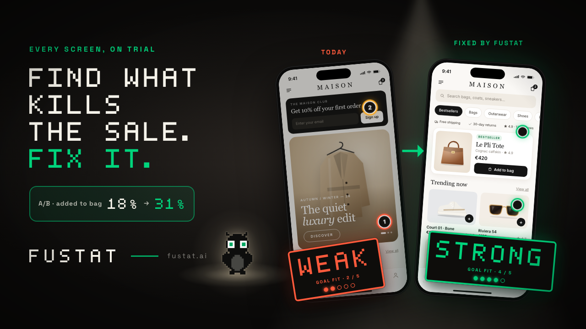

<picture>
  <source media="(prefers-color-scheme: dark)" srcset="assets/header-dark.svg">
  
</picture>

<picture>
  <source media="(prefers-color-scheme: dark)" srcset="assets/path-dark.svg">
  
</picture>

  
  
  
  
  
  

  <code>LLM-as-judge</code> · <code>evals &amp; graders</code> · <code>golden sets</code> · <code>model routing</code> · <code>ensembling</code> · <code>self-consistency</code> · <code>agents</code> · <code>MCP</code> · <code>Claude Code</code>

<picture>
  <source media="(prefers-color-scheme: dark)" srcset="assets/evals-dark.svg">
  
</picture>

## Shipping now

| | What | Proof |
|---|---|---|
| **[fustat.ai](https://fustat.ai)** | **Design-Goal Fit.** A critic reviews every screen against the business goal it should move. A separate LLM-as-judge scores the critique on a six-dimension rubric, validated at 82% agreement with human labels; a persona ensemble reaches the verdict, and human overrides teach it the team's bar. | 20 customers in month one |
| **[EBS Dx](https://ebs.edu.sa)** | **Agentic AI executive education for Saudi leaders.** Role-based learning paths, a Challenge Lab with feedback on every decision, and Saria, an AI learning companion, in Arabic and English. I advise on AI. | Licensed by TVTC & NELC · backed by the Ministry of Investment |
| **[korba.ai](https://korba.ai)** | **Build AI workflows visually.** Drag skills, agents and MCP connectors onto a canvas, wire them into flows, and let them run. | 600 users · free for Mac |
| **[telos](https://github.com/ProductVoyagers/telos)** | The open-source Claude Code plugin behind fustat: critique flows against Key Results, not taste. | Open source |
| **[pm-os](https://github.com/ritualspm/pm-os)** | The AI-native PM team OS: four agent roles on shared skills and files, installable in Claude Cowork. | Capstone of AI PM Builders |
| **[claude-101](https://github.com/ritualspm/claude-101)** | Learn Claude by using Claude: a 25-lesson interactive course that runs inside Claude. | Open course by rituals.pm |

## [fustat.ai](https://fustat.ai): every screen, on trial

Finds what kills the sale and fixes it. Each screen is judged against the business goal it has to move, not against taste.

**Every opinion ships with proof.** A critic writes the critique; a separate, read-only judge scores it on a six-dimension rubric (/30, pass at 24). The judge is validated, not assumed: **82% agreement with human labels** (9/11, labelled blind to the judge's score; an early baseline, re-run at n ≥ 30), and a threshold sweep confirmed 24/30 as the optimal cut.

`LLM-as-a-judge` · `rubric scoring` · `ground-truth anchoring` · `confidence calibration` · `golden-set regression` · `offline + online evals` · `preference / RLHF-ready corpus` · `prompt caching` · `model routing`

<picture>
  <source media="(prefers-color-scheme: dark)" srcset="assets/fustat-dark.svg">
  
</picture>

## [korba.ai](https://korba.ai): the AI browser you work in, with your agents

Build AI workflows visually. Drag skills, agents and MCP connectors onto a canvas, wire them into flows, and let them run. 600 users and counting.

<picture>
  <source media="(prefers-color-scheme: dark)" srcset="assets/korba-dark.svg">
  
</picture>

<b>The full path</b>: every role, chapter by chapter

### Applied AI at scale · 2022 → now

- **Delivery Hero** · Sr. Director of Product, Growth & AI, Quick Commerce 
  7 brands · 17 squads · 75 countries. Grew quick commerce from 4% to 19% of GMV contribution. Led the largest programme in the company: moving the experience from store-first to item-first. Built the product operating model for all of Quick Commerce, and founded the AI practice applying LLMs to content enrichment and discovery.
- **[EBS Dx](https://ebs.edu.sa)** · AI Advisor (2026 → now) 
  Advise on AI for an agentic executive-education platform for Saudi public-sector and enterprise leaders; licensed by TVTC and the National eLearning Center, backed by the Ministry of Investment.
- **ProductVoyagers Labs** · Founder 
  My AI studio: [fustat](https://fustat.ai), [korba](https://korba.ai) and [telos](https://github.com/ProductVoyagers/telos).
- **[rituals.pm](https://rituals.pm)** · Co-founder 
  A product network for EMEA: 2,000+ PMs and 55+ founders from 10 countries. I lead AI PM Builders, where PMs ship a real AI product to production in four weeks, spec'd, built, evaluated and priced; now in cohort 3, in Arabic and English. Open-sourced [pm-os](https://github.com/ritualspm/pm-os) and [claude-101](https://github.com/ritualspm/claude-101).
- **Maven & Zomra** · Instructor 
  Teaching LLMs, agents and Claude to product builders.

### Consumer platforms at scale · 2020 → 2022

- **Wayfair** · Product Lead, Internationalization 
  ML localization protecting $1.6B annual revenue: +24% accuracy, −48% time-to-market.
- **Careem (Uber)** · Lead PM, Super App 
  Launched MENA's first Super App: 48M users, +31% discovery.

### Data products · 2018 → 2020

- **Boeing Data Analytics Labs** · Sr. Strategic Product Manager 
  Aviation data marketplace serving 150+ operators; cloud costs −45%. Star Performer 2018.

### Enterprise systems · 2006 → 2018

- **Ericsson** · Strategic Product Manager, Solutions Architect, Integrator
- **Nokia** · Senior Consultant
- **Etisalat** · CRM / Billing & Provisioning Lead
- **ITWorx** · Senior Lead Software Engineer

Started as a software engineer and spent 12 years integrating billing, CRM and content systems into large telecom operators across Europe, the Middle East and Asia. That's where I learned how enterprises actually adopt software, which is now the hard part of AI.

### Education

- **Durham University Business School** · Executive MBA

## What I believe
Models are no longer the bottleneck. **Evaluation, integration and adoption are.** Everything above is one of those three.

## Writing & talks
- **[Product Voyagers](https://www.productvoyagers.com)**: essays on product and AI
- **Conference speaker for 3+ years** on product and AI across Europe, the Middle East and Africa, including Product School's ProductCon
- Recent: AI Product Summit Berlin 2026, roundtable host and panelist
- [Product School](https://productschool.com/product-leaders/ahmed-wafaey): instructor and featured speaker
